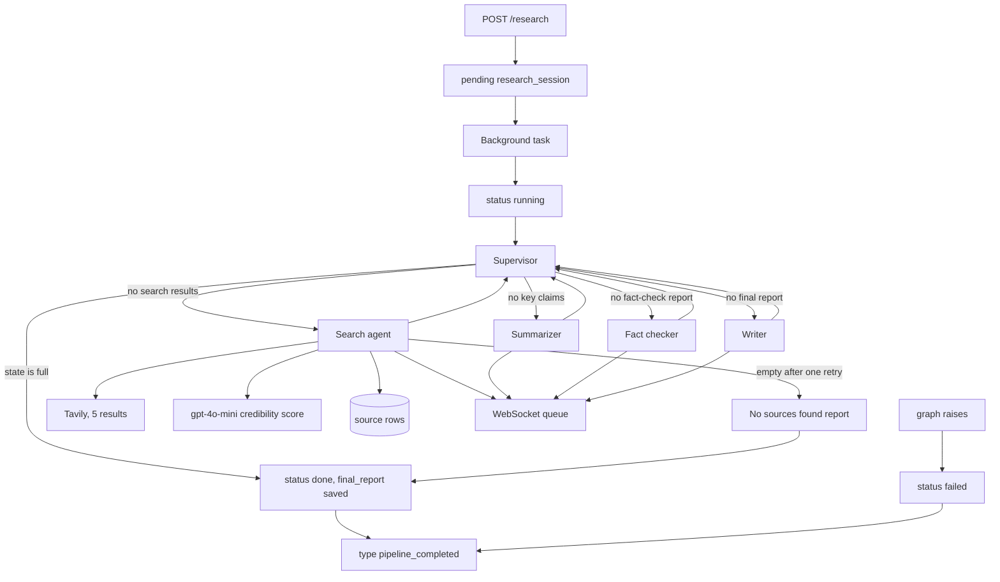
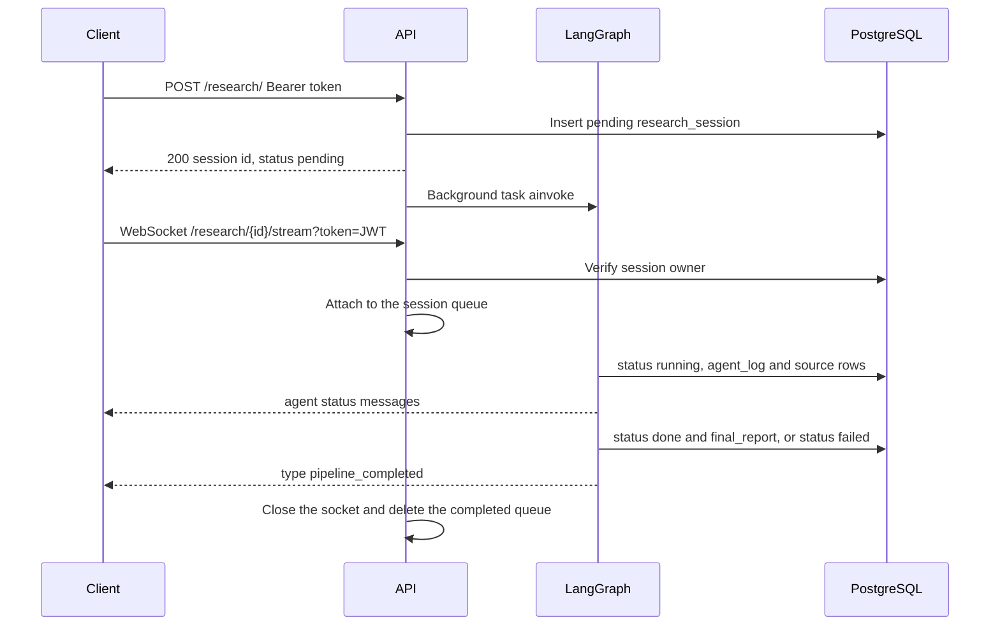

# QueryNest — Backend

[](https://github.com/raosam23/query-nest-backend/actions/workflows/ci.yml)

[](https://www.python.org/)
[](https://fastapi.tiangolo.com/)
[](https://langchain-ai.github.io/langgraph/)
[](https://www.langchain.com/)
[](https://platform.openai.com/)
[](https://docs.tavily.com/)
[](https://www.postgresql.org/)
[](https://sqlmodel.tiangolo.com/)
[](https://docs.pydantic.dev/)
[](https://www.docker.com/)

[](https://docs.astral.sh/uv/)
[](https://docs.astral.sh/ruff/)
[](https://docs.pytest.org/)

FastAPI backend for [QueryNest](https://github.com/raosam23/query-nest-frontend), a multi-agent research assistant. A signed-in user submits one question. The API stores a research session and runs a LangGraph pipeline in the background: search the web, score each source, extract claims, fact-check them, and write a report. A WebSocket on that session streams agent progress while the run is in flight.

The Next.js client lives in [raosam23/query-nest-frontend](https://github.com/raosam23/query-nest-frontend). Local Docker Compose for Postgres, this API, and the frontend lives in [raosam23/query-nest-infra](https://github.com/raosam23/query-nest-infra).

## Features

- Register and login. Passwords are bcrypt hashes. Login returns a JWT in the JSON body. Protected routes read `Authorization: Bearer`.
- Start a research session with `POST /research/`. The response is the pending session. The LangGraph run is a FastAPI background task.
- A rule-based supervisor routes between four agents: search, summarize, fact-check, and write. The supervisor is Python, not another model call.
- Web search through Tavily (five results). Each result is saved as a `source` row. `gpt-4o-mini` scores credibility from 0.0 to 1.0.
- Agent start and finish rows in `agent_log`, plus a live WebSocket message for each.
- The writer’s text or a clear empty-result outcome is stored as `final_report`. A failed setup or graph run sets status `failed` and still notifies the socket.
- List and delete the current user’s past sessions.
- A Docker image and a Compose stack (in the infra repo) that includes PostgreSQL 16.

## Architecture

`POST /research/` inserts a `pending` row and returns it. `run_research_graph` then opens its own database session, marks the row `running`, and invokes the compiled graph. Agents share that session through `ResearchState.db_session`, so source rows and agent logs commit on the background task’s connection.



| Node | Reads | Writes | What it calls |
| --- | --- | --- | --- |
| Supervisor | `search_results`, `key_claims`, `fact_check_report`, `final_report`, retry counters | `next` | Nothing. Retries empty search and summarizer output once, then ends with a clear report |
| Search | `query` | `search_results`, `source` rows | Tavily, then one chat completion per result |
| Summarizer | `search_results` | `key_claims` (one string, the model text) | `gpt-4o-mini` |
| Fact checker | `key_claims` | `fact_check_report` (`{"report": <model text>}`) | `gpt-4o-mini` |
| Writer | `query`, `key_claims`, `fact_check_report` | `final_report` | `gpt-4o-mini` |

`search_results` and `key_claims` use an additive reducer, so each node appends. The fact-check prompt asks the model to label claims `verified`, `contradicted`, or `uncertain`. The handler stores that reply as text. It does not parse those labels into columns. The writer prompt asks for Summary, Key Claims, Fact Check, Conclusion, and references. The session stores the reply as one string.

The chat model is constructed at import in `app/agents/llm.py`: `gpt-4o-mini`, temperature `0.0`, API key read from settings when the client needs it. The Tavily tool is also constructed at import, with `max_results=5`, so the process needs `OPENAI_API_KEY` and `TAVILY_API_KEY` to start.

### Request and socket

Connect to `/research/{session_id}/stream` after `POST /research/` returns. Pass the JWT from `/auth/login` as a `token` query parameter. The server validates the token and checks that the session belongs to its owner. Invalid tokens and sessions are closed with code `1008` before any events are streamed.



Queues are created with the research session and also lazily on the first event. Reconnecting preserves queued messages. An idle queue with no connected client expires after five minutes. The handler closes only after `pipeline_completed`; an individual agent failure does not stop the rest of the stream. The completion message includes `status` and, on failure, a short `error`.

If Tavily returns no results, the supervisor retries search once and then completes with `final_report: "No sources found for this query after retrying the search."`. If summarization returns no claims, it also retries once before completing with a clear report. Both empty-result cases mark the agent log as failed.

## Tech stack

| Layer | Choice |
| --- | --- |
| API | FastAPI, Uvicorn |
| Agent graph | LangGraph `StateGraph` |
| LLM and search tool | LangChain `ChatOpenAI`, `TavilySearchResults` |
| Chat model | OpenAI `gpt-4o-mini`, temperature 0 |
| Web search | Tavily, five results |
| Database | PostgreSQL through asyncpg |
| ORM | SQLModel, SQLAlchemy asyncio |
| Auth | python-jose (JWT) and bcrypt |
| Packaging | uv, Python 3.12+ |

Alembic is listed in `pyproject.toml`. This repo has no `alembic/` directory. `init_db` runs `SQLModel.metadata.create_all` during application startup. `app/db/database.py` imports `app.db.models` so those tables are registered before `create_all`.

## Project structure

```
app/
├── main.py                  # FastAPI app, CORS, routers, GET /health, lifespan init_db
├── agents/
│   ├── llm.py               # ChatOpenAI instance, built at import
│   ├── state.py             # ResearchState
│   ├── supervisor.py        # Rule-based next-step and the route function
│   ├── search_agent.py      # Tavily search, credibility score, source rows
│   ├── summarizer_agent.py  # Key claims
│   ├── fact_checker.py      # Fact-check text
│   ├── writer_agent.py      # Final report
│   └── db_helpers.py        # agent_log rows and WebSocket pushes
├── api/
│   ├── dependencies.py      # HTTP Bearer and get_current_user
│   └── routes/              # auth, research, history, websocket
├── core/                    # Settings, JWT, StreamManager
├── db/                      # Async engine, session, SQLModel tables
├── graph/builder.py         # Compiled StateGraph
└── services/                # Register, login, history, research orchestration
tests/                       # Pytest suite, no network and no real keys
.github/workflows/ci.yml     # Lint, type check, test
```

## Setup

Requirements: Python 3.12+, [uv](https://docs.astral.sh/uv/getting-started/installation/), PostgreSQL, an OpenAI API key, and a Tavily API key. Both keys are read while importing the app.

```bash
git clone https://github.com/raosam23/query-nest-backend.git
cd query-nest-backend
uv sync
cp .env.example .env
```

Fill in `DATABASE_URL`, `JWT_SECRET`, `OPENAI_API_KEY`, and `TAVILY_API_KEY`. Then start the API. Startup creates the tables.

```bash
uv run uvicorn app.main:app --reload
```

| URL | Purpose |
| --- | --- |
| http://localhost:8000 | API |
| http://localhost:8000/docs | Swagger UI |
| http://localhost:8000/redoc | ReDoc |
| http://localhost:8000/health | Health check |

The engine is created with `echo=True`, so SQL is written to the server log. The engine does not set `ssl=require`. Add that to `DATABASE_URL` when the host requires SSL.

CORS allows every origin and sets `allow_credentials=True`. A simple response sends `Access-Control-Allow-Origin: *`. A preflight response echoes the request `Origin`.

### Docker

The image installs uv, runs `uv sync --frozen` (the dev group is included), and starts Uvicorn with `--reload` on port 8000. The process creates tables on startup, so Postgres has to be reachable before the process boots. `localhost` inside the container is the container, not the host.

```bash
docker build -t query-nest-backend .
docker run --env-file .env -p 8000:8000 query-nest-backend
```

[query-nest-infra](https://github.com/raosam23/query-nest-infra) runs three services with Compose: Postgres 16 (`postgres` / `postgres`, database `querynest`, port 5432), this API on port 8000, and the Next.js app on port 3000. Clone the three repos as sibling directories `backend`, `frontend`, and `infra`. The Compose file builds `../backend`, sets `DATABASE_URL` to `postgresql+asyncpg://postgres:postgres@db:5432/querynest`, and reads the rest of the API settings from `../backend/.env`.

```bash
cd infra
docker compose up --build
```

### Environment variables

| Variable | Required | Default | Purpose |
| --- | --- | --- | --- |
| `DATABASE_URL` | Yes | | Async URL, `postgresql+asyncpg://...` |
| `JWT_SECRET` | Yes | | HMAC secret for access tokens |
| `JWT_ALGORITHM` | No | `HS256` | Algorithm passed to python-jose |
| `JWT_EXPIRE_MINUTES` | No | `60` | `exp` claim lifetime |
| `OPENAI_API_KEY` | Yes | | Key for `ChatOpenAI`. Required at import |
| `TAVILY_API_KEY` | Yes | | Key for `TavilySearchResults`. Required at import |

## API

Routes are mounted at the application root. There is no `/api` prefix. Protected routes expect `Authorization: Bearer <token>`. A missing token returns `401` with `Not authenticated`. A bad token returns `401` with `Invalid token`. A token whose user row is missing returns `401` with `User not found`.

Register, login, `GET /health`, the docs, and the WebSocket do not require a token.

### Health

| Method | Path | Auth | Description |
| --- | --- | --- | --- |
| `GET` | `/health` | No | Returns `{"status": "ok"}` |

### Authentication — `/auth`

| Method | Path | Auth | Description |
| --- | --- | --- | --- |
| `POST` | `/auth/register` | No | Body `{email, password}`. `200` and `{message, email}`. `400` if the email exists |
| `POST` | `/auth/login` | No | Body `{email, password}`. `200` and `{access_token, token_type}` with `token_type` `bearer`. `401` for an unknown email or a wrong password |

There is no minimum password length. Both login failures use the detail `Invalid credentials`. The password hash is not returned. There is no logout route and no current-user route. The token is not set as a cookie.

### Research — `/research`

| Method | Path | Auth | Description |
| --- | --- | --- | --- |
| `POST` | `/research/` | Yes | Body `{query}`. `query` must be at least 1 character. Returns the pending session and schedules the graph |
| `GET` | `/research/{session_id}` | Yes | One session owned by the caller. `404` with `Session not found` otherwise |
| `GET` | `/research/{session_id}/sources` | Yes | Sources saved for that session. `404` when the session is missing or owned by someone else |

A session payload is `{id, query, status, final_report, created_at}`. `status` is `pending`, `running`, `done`, or `failed`. `final_report` is null until the writer finishes or an empty-result outcome is available. A source payload is `{id, url, title, snippet, credibility_score}`. `snippet` is the Tavily `content` field. `credibility_score` is null when the model reply is not a float.

### History — `/history`

| Method | Path | Auth | Description |
| --- | --- | --- | --- |
| `GET` | `/history/` | Yes | The caller’s sessions, newest `created_at` first |
| `DELETE` | `/history/{session_id}` | Yes | Deletes that session. `200` and `{status: 200, msg: "Session deleted successfully"}`. `404` when it is missing |

### WebSocket — `/research/{session_id}/stream`

```javascript
const token = "<access_token from /auth/login>";
const ws = new WebSocket(
  `ws://localhost:8000/research/{session_id}/stream?token=${encodeURIComponent(token)}`
);
ws.onmessage = (event) => console.log(JSON.parse(event.data));
```

| Message | When |
| --- | --- |
| `{"agent": "search_agent", "status": "running"}` | That agent’s log row was inserted. The same shape is used for `summarizer_agent`, `fact_checker_agent`, and `writer_agent` |
| `{"agent": "<name>", "status": "done", "output": "<text>"}` | The agent finished. `status` is `failed` when the agent recorded an error |
| `{"type": "pipeline_completed", "status": "done"}` | The background task finished successfully |
| `{"type": "pipeline_completed", "status": "failed", "error": "..."}` | Setup or graph execution failed |

Search outputs look like `Found 5 results`. The summarizer output is `Extracted key claims succesfully`. The fact checker output includes the claim count. The writer output includes the report length. Failures store `Error: ...` or a fixed message such as `Search results are empty`.

## Testing

The suite is pytest. It does not need Postgres, OpenAI, Tavily, or any other network service. `tests/bootstrap.py` sets dummy environment variables when they are not already present, and CI sets the same placeholders. LangSmith tracing is turned off in that bootstrap.

```bash
uv sync
uv run pytest
uv run pytest --cov=app --cov-report=term-missing
uv run ruff check . --exclude alembic/ --select=E,F --ignore=E501,F821
uv run pyright
```

| Area | What is covered |
| --- | --- |
| `tests/test_security.py` | bcrypt hashes and JWT create, decode, expiry, tamper, wrong secret, and missing subject |
| `tests/test_dependencies.py` | `get_current_user` success, bad token, missing subject, unknown user |
| `tests/test_auth_guard.py` | `401` on the protected HTTP routes |
| `tests/test_schemas.py` | Auth, research, source, and delete validation |
| `tests/test_models.py` | Status enums and the columns the API returns |
| `tests/test_config_and_database.py` | Settings defaults, SQL echo, `get_session`, and `init_db` |
| `tests/test_stream.py` | Queue create, push, missing session, and remove |
| `tests/test_db_helpers.py` | Agent log insert, done, failed, and missing row |
| `tests/test_agents.py` | Search, credibility parsing, summarizer, fact checker, writer, and supervisor routing |
| `tests/test_graph.py` | Compiled edges, one full mocked run, and bounded retry after empty search |
| `tests/test_auth_service.py` | Register, duplicate email, login, wrong password |
| `tests/test_history_service.py` | List order and delete |
| `tests/test_research_service.py` | Create, successful graph, failed graph, missing row completion event, sources |
| `tests/test_auth_routes.py` | Register and login HTTP responses |
| `tests/test_research_routes.py` | Start, fetch, sources, blank query |
| `tests/test_history_routes.py` | List and delete |
| `tests/test_websocket.py` | JWT and session ownership, stream framing, disconnect, and a live socket |
| `tests/test_main.py` | `GET /health`, CORS, docs, and startup `init_db` |

Mocking:

| Dependency | How |
| --- | --- |
| Database | `AsyncMock` session. `add` stays synchronous, matching SQLAlchemy |
| FastAPI dependencies | `app.dependency_overrides` for `get_session` and `get_current_user` |
| OpenAI | The module-level `ChatOpenAI` is replaced. `ainvoke` is an `AsyncMock` |
| Tavily | The module-level search tool is replaced. Tests never call the API |
| Graph run from HTTP | `run_research_graph` is an `AsyncMock` in the route tests. Service tests call the real function with a fake graph |
| Startup | `init_db` is patched so `TestClient` does not connect |
| WebSocket | The handler is awaited with a mock socket, and one test uses `TestClient.websocket_connect` |

## CI

`.github/workflows/ci.yml` runs on pushes and pull requests to `main`. Lint, type checking, and tests are separate jobs, so a failure in one is visible on its own. Each job installs dependencies with `uv sync --frozen` (the dev group is included by default).

| Job | What it runs |
| --- | --- |
| Lint | `ruff check` for pycodestyle and pyflakes (`E501` and `F821` ignored, Alembic excluded). `ruff format --check` is allowed to fail without failing the job. |
| Type Check | `pyright`, allowed to fail without failing the job. |
| Test | `pytest` with coverage of `app`. The job fails if coverage drops below 99%. |
